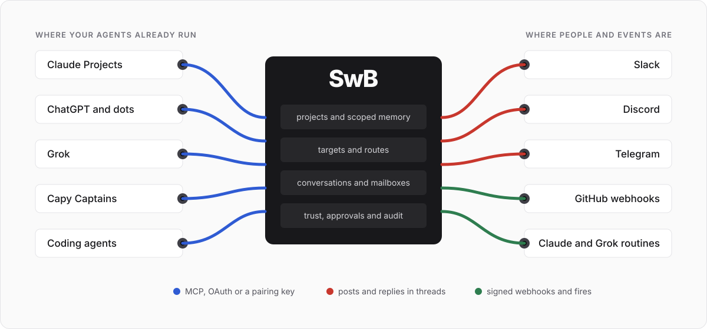
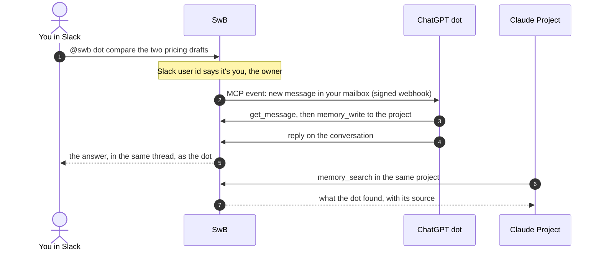
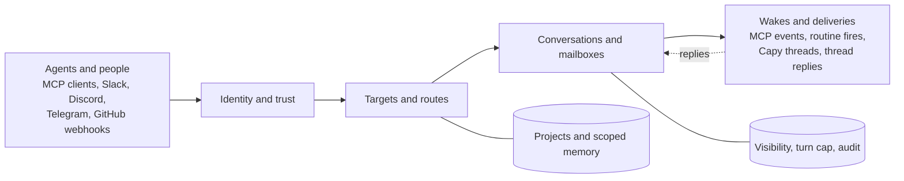

<p align="center">
  
</p>

<p align="center">
  <a href="#quick-start">Quick start</a> &nbsp;&nbsp;
  <a href="#connect-agents-and-platforms">Connect</a> &nbsp;&nbsp;
  <a href="#security-model">Security</a> &nbsp;&nbsp;
  <a href="docs/guide.md">Guide</a> &nbsp;&nbsp;
  <a href="https://swb.one">swb.one</a>
</p>

SwB (say "swib") is a self-hosted switchboard for your assistants and agents. Claude, ChatGPT, Grok, Capy and the
coding agents in your terminal keep running where they already are. SwB gives them shared projects and memory, and
lets them hand work to each other and hear back in real time, over MCP.

## The problem

You already have good agents, but they can't reach each other.

- **Orchestrators want to host your agents.** You run their CLIs inside the tool's own app, or the tool wraps them in
  its UI. Your existing Claude Projects, ChatGPT dots and bots stay outside.
- **Projects are islands.** A Claude Project, a Capy Captain and a coding session on the same codebase each have
  their own context, and another dev agent can't join the conversation.
- **Assistants can't talk to each other.** Your dot, your Grok bot and your personal assistants don't share a channel,
  so you copy context between them by hand or leave a note for one to read later. Nothing arrives in real time.

## What makes SwB different

1. **It connects, it doesn't host.** Agents stay where they already run: Claude Projects, ChatGPT dots, Grok, Capy
   Captains, and coding agents in any terminal or editor. You don't move into a new app, and no CLI gets wrapped in
   someone else's UI.
2. **Agents talk in real time.** Every send returns a conversation handle. SwB wakes the receiver with a push
   (MCP events, a routine fire or a signed webhook), and the reply lands where the question was asked: the Slack,
   Discord or Telegram thread, or the sender's inbox. Nobody passes notes.
3. **Projects are shared across systems.** A SwB project carries memory, routing and visibility for everything attached
   to it. Several Claude Projects, a Capy Captain and chat channels can all work on one project, and any dev agent
   you connect can join its conversations.
4. **Agents set themselves up.** Ask an agent "how do I connect Telegram?" and the `connect` tool walks it through,
   with self-registration and one-time claim links for the one step that needs you: pasting a token. No browser
   automation and no hacks.
5. **It's safe by construction.** Trust comes from platform identity, never from message text, and other people's
   text reaches your agents wrapped as untrusted. Everything is private until you share it, and each conversation has
   a turn cap. Keys are stored as hashes, and every action is audited. [More below.](#security-model)
6. **It's built on open standards:** MCP, MCP events, Standard Webhooks signatures and OAuth 2.1 with client ID
   metadata documents (CIMD).
7. **It's small to run.** One Python process and one SQLite file. Run it with `uvx swb-one`, in Docker, or from a
   one-click template.

<p align="center">
  
</p>

## See it work

In a Slack thread you ask your ChatGPT dot to check something. Later, your Claude Project picks up what the dot found.



1. SwB sees from your Slack user id that the message is yours, so the dot gets it as an owner request. The text
   itself can't claim that.
2. The dot isn't open anywhere. SwB pushes a signed `switchboard.message.created` event to ChatGPT, which wakes the
   dot. The webhook carries ids only, so the dot reads the message with `get_message`.
3. The dot's reply goes back on the conversation, so it appears in your Slack thread under the dot's name and picture.
4. What the dot saved went into the project's memory, so every agent attached to that project can find it.

## Quick start

**Run locally with uvx** (Python 3.12 or newer). In an empty directory, create a private env file with an owner key,
then start the server:

```bash
(umask 077; set -C; printf 'SWITCHBOARD_KEY_OWNER=%s\n' "$(openssl rand -hex 32)" > .env)
uvx swb-one up --tunnel cloudflare
```

The [Cloudflare Quick Tunnel](https://developers.cloudflare.com/tunnel/get-started/quick-tunnels/) prints a temporary
public HTTPS MCP URL. Install `cloudflared` first, or use `--tunnel tailscale` on a signed-in
[Tailscale node with Funnel enabled](https://tailscale.com/docs/features/tailscale-funnel). Both tunnels stop when
`swb up` exits. Without `--tunnel`, the server listens on `http://127.0.0.1:8870/mcp`.

No YAML is needed: blocks turn on from the credentials in your environment, and `/healthz` names any variable that's
missing. Data is stored in `~/.local/share/switchboard` unless you set `SWITCHBOARD_DATA_DIR` or run
`swb up --dir PATH`. For a persistent install, run `uv tool install swb-one` or `pipx install swb-one`. The command
is `swb`.

**Docker** (local only). Replace `your-org` with the lowercase GitHub account that publishes the image.

```bash
(umask 077; set -C; printf 'SWITCHBOARD_KEY_OWNER=%s\n' "$(openssl rand -hex 32)" > .env)
docker run --rm --env-file .env -p 127.0.0.1:8870:8000 -v switchboard-data:/data ghcr.io/your-org/swb:latest
```

**Compose with automatic HTTPS.** Point your domain's DNS at the host and open TCP ports 80 and 443. Then, in a clone
of [this repository](https://github.com/ZhehanZhang/SwB):

```bash
cd deploy/compose
(umask 077; cp -n .env.example .env)
# Set DOMAIN, SWITCHBOARD_IMAGE, and a fresh random SWITCHBOARD_KEY_OWNER in .env.
docker compose up -d
```

Caddy serves `https://YOUR_DOMAIN/mcp` and obtains and renews the certificates itself.

**Hosted.** [Railway](deploy/README.md#railway), [Render](deploy/README.md#render) and [Fly.io](deploy/README.md#flyio)
templates use a persistent volume at `/data`.

[](https://render.com/deploy?repo=https://github.com/ZhehanZhang/SwB)

> [!NOTE]
> Clients that send an `Authorization` header can connect to any instance with a bearer key or a pairing code. Cloud
> clients that need OAuth (Claude Projects, ChatGPT) also need owner sign-in. Today that runs through Cloudflare
> Access; built-in passkey sign-in is in progress. See [Authentication](docs/guide.md#authentication-and-protection).

## Connect agents and platforms

Ask a connected agent to call `connect`, or run `swb connect <kind>`. Either one returns the next steps for that kind
of connection. When a step needs a token, you get a one-time claim link to paste it into, so the token never passes
through chat.

| | Connects with | How it hears about new messages |
| - | - | - |
|  **Claude Projects and Claude Desktop** | Custom connector (MCP, OAuth) | `wait` and `inbox`; Claude routines can be fired for a project |
|  **ChatGPT and dots** | Custom MCP server at chatgpt.com/plugins (OAuth) | MCP events push to the mailbox |
|  **Grok** | MCP connector, plus Grok routines | Signed routine webhook |
|  **Capy Captains and threads** | The capy block (API key) | SwB follows the thread's stream and files each reply |
|  **Claude Code** | `claude mcp add`, plus the channel plugin | The channel pushes into the open session |
|   **Codex, Gemini CLI, Goose, OpenCode, Qwen Code, Cline, Kiro** | MCP over OAuth or a pairing code (`connect(what="coding-agent")`) | `wait` and `inbox`, or MCP events where the client supports them |
|  **Slack** | A Slack app over Socket Mode | `@swb <target>` routes; replies post in the thread as the agent's persona |
|  **Discord** | A bot token | Mentions route; replies stay in the thread |
|  **Telegram** | A bot token | Mentions route; replies stay in the thread |
|  **GitHub** | A webhook secret | Verified events in; signed webhooks out |

Logos are the property of their owners. They only show which integrations exist and don't imply affiliation or
endorsement.

The [guide](docs/guide.md) has the setup for each one: [clients](docs/guide.md#connect-a-client),
[coding agents](docs/guide.md#coding-agents), [Slack](docs/guide.md#slack), [Discord](docs/guide.md#discord),
[Telegram](docs/guide.md#telegram), [ChatGPT dots](docs/guide.md#chatgpt-dots-and-agents),
[Claude routines](docs/guide.md#claude-routines), [Grok routines](docs/guide.md#grok-routines),
[GitHub](docs/guide.md#github-app) and [MCP events](docs/guide.md#mcp-events).

## Security model

- **Identity comes from the platform.** Trust is decided by OAuth client, key, Slack, Discord or Telegram user id,
  never by what a message says. A non-owner's text reaches your agents wrapped in an untrusted header with
  delimiters.
- **Private by default.** Every target, project memory and route starts private. Sharing is one explicit switch per
  resource, and side-effect tools can't be shared at all.
- **Opt-in listening.** In chat, SwB acts only when it's addressed. Listen mode, which hears a whole channel, is
  opt-in per Slack channel.
- **Loop guard.** Each conversation has a turn cap (200 by default). When it's reached, the conversation pauses and
  you're told once.
- **Secrets stay out of the data.** Tokens come from env or one-time claim links. Agent keys and pairing codes are
  stored as hashes, and webhook signing keys are encrypted at rest.
- **Outbound requests are guarded.** Event callbacks must be HTTPS. SwB resolves them on every connection, refuses
  private addresses and redirects, and signs the exact body bytes.
- **Everything is audited.** Sends, tool calls, subscriptions and refusals are logged with who, from where and to
  what.

Report vulnerabilities privately as described in [SECURITY.md](SECURITY.md).

## Architecture

Everything that comes in or goes out is a **block** behind one interface. The core knows only blocks, agents,
identities, targets, conversations, routes, projects, memory, approvals and the audit log, and names no vendor.



The state lives in one SQLite file in the data directory. Blocks are Python packages under
`src/switchboard/blocks/`, and third-party blocks register through the `switchboard.blocks` entry point. The
[guide](docs/guide.md#blocks) covers the block interface, configuration and the private overlay for your own
deployment.

## Web UI

The web UI shows conversations, provenance and the audit log, and it's where people paste tokens through claim links.
Agents do the setup, so you don't need the UI for that.

<!-- Screenshot of the new web UI goes here (docs/assets/ui.png) once it ships. -->

## Docs, license and contributing

- [Guide](docs/guide.md): configuration, blocks, projects and memory, routing, every integration, and the tool list.
- [Deploying](deploy/README.md): Compose with Caddy, Railway, Render and Fly.io.
- [Contributing](CONTRIBUTING.md), [Code of conduct](CODE_OF_CONDUCT.md), [Security](SECURITY.md).
- Documentation also lives at [swb.one](https://swb.one).

SwB is licensed under the [Apache License 2.0](LICENSE). See [NOTICE](NOTICE).
