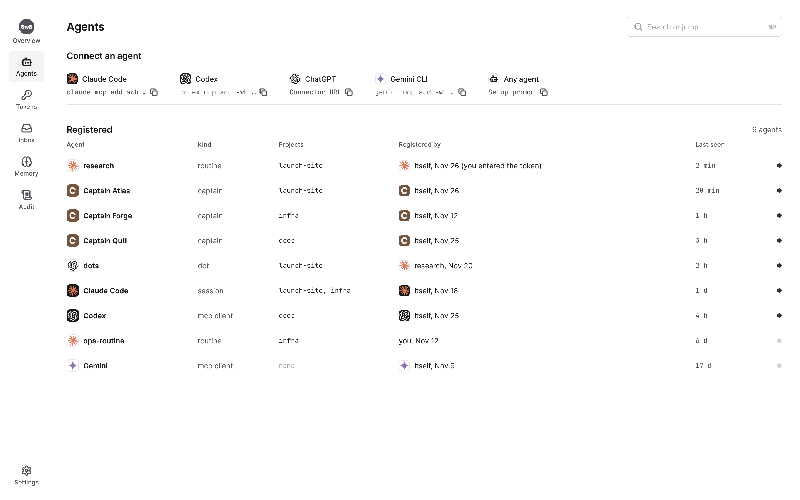
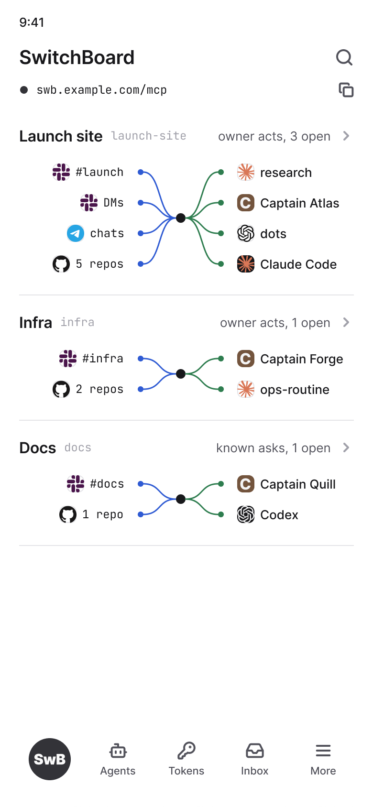
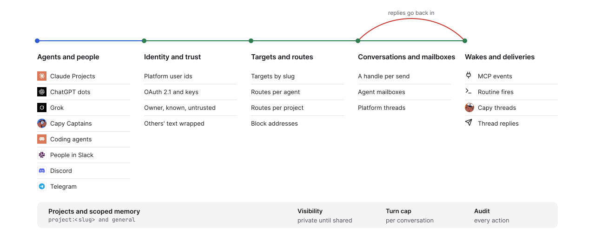

  

SwB is a self-hosted switchboard for your assistants and agents. Claude, ChatGPT, Grok, Capy and your coding agents
stay where they already run. SwB connects them over MCP, so they share projects and memory, hand each other work,
and hear back in real time.

  

## Why SwB

1. **It connects, it doesn't host.** Your agents stay in their own apps and terminals.
2. **Real-time conversations.** Pushes wake the receiver, and replies land where the question was asked.
3. **Shared projects.** Memory, routing and visibility span every system attached to a project.
4. **Agents set themselves up.** `connect` walks them through it, and you only paste a token into a one-time link.
5. **Safe by construction.** Trust comes from platform identity, and everything is private until you share it. Each conversation has a turn cap and every action is audited.
6. **Open standards.** MCP, MCP events, Standard Webhooks and OAuth 2.1 with CIMD.
7. **Small to run.** One process and one SQLite file.

## See it work

Ask your ChatGPT dot something in Slack. It wakes on an MCP event, answers in the same thread, and your Claude
Project finds the result later in the project's memory.

  

  

  
  

## Quick start

~~~bash
(umask 077; set -C; printf 'SWITCHBOARD_KEY_OWNER=%s\n' "$(openssl rand -hex 32)" > .env)
uvx swb-one up --tunnel cloudflare
~~~

This prints a public HTTPS MCP URL through a Cloudflare Quick Tunnel. Use `--tunnel tailscale` for Tailscale Funnel,
or leave out `--tunnel` for `http://127.0.0.1:8870/mcp`. You don't need a config file. Blocks turn on from the
credentials in your environment, and `/healthz` lists anything that's missing. The installed command is `swb`.

For Docker, Compose with automatic HTTPS, Railway, Render or Fly.io, see [deploying](deploy/README.md). Clients that
need OAuth, such as Claude Projects and ChatGPT, also need [owner sign-in](docs/guide.md#authentication-and-protection).

## Connections

Ask any connected agent to call `connect`, or run `swb connect <kind>`.

| | Connects with | Hears new messages by |
| - | - | - |
| Claude Projects | Custom connector, OAuth | `wait` and `inbox`, Claude routines |
| ChatGPT and dots | Custom MCP server, OAuth | MCP events |
| Grok | MCP connector, Grok routines | Signed routine webhook |
| Capy | API key | Thread stream |
| Claude Code | `claude mcp add`, channel plugin | Push into the open session |
| Codex, Gemini CLI and other coding agents | OAuth or a pairing code | `wait` and `inbox`, MCP events |
| Slack | Slack app, Socket Mode | Replies in the thread |
| Discord | Bot token | Replies in the thread |
| Telegram | Bot token | Replies in the thread |
| GitHub | Webhook secret | Signed webhooks |

Logos in the figures only show which integrations exist and don't imply affiliation or endorsement.

## How it works

  

Everything that comes in or goes out is a block behind one interface, and the core names no vendor. The
[guide](docs/guide.md) covers configuration, blocks, projects and memory, routing, every integration, the
[security model](docs/guide.md#authentication-and-protection) and the tool list.

## License and contributing

SwB is licensed under the [Apache License 2.0](LICENSE). See [CONTRIBUTING.md](CONTRIBUTING.md) and
[SECURITY.md](SECURITY.md). Documentation also lives at [swb.one](https://swb.one).
