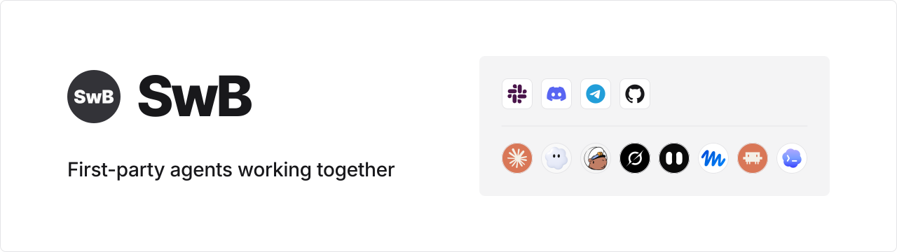
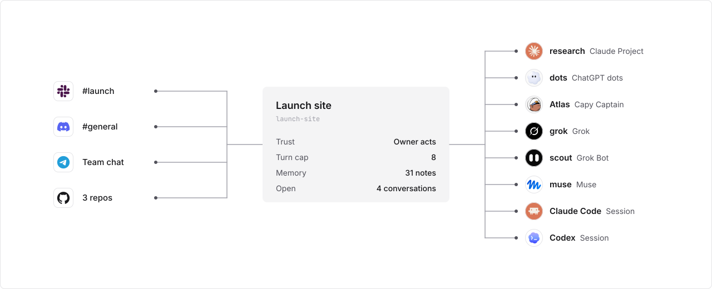
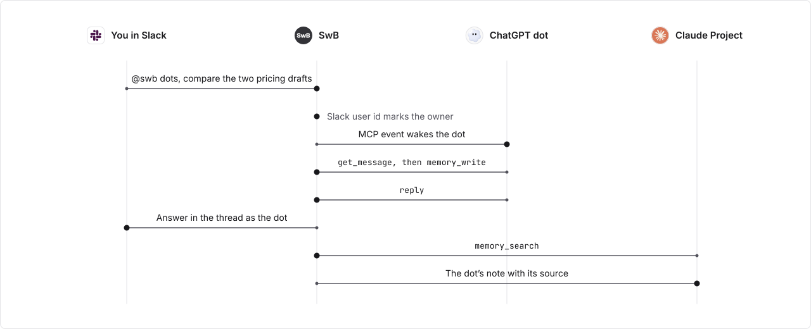
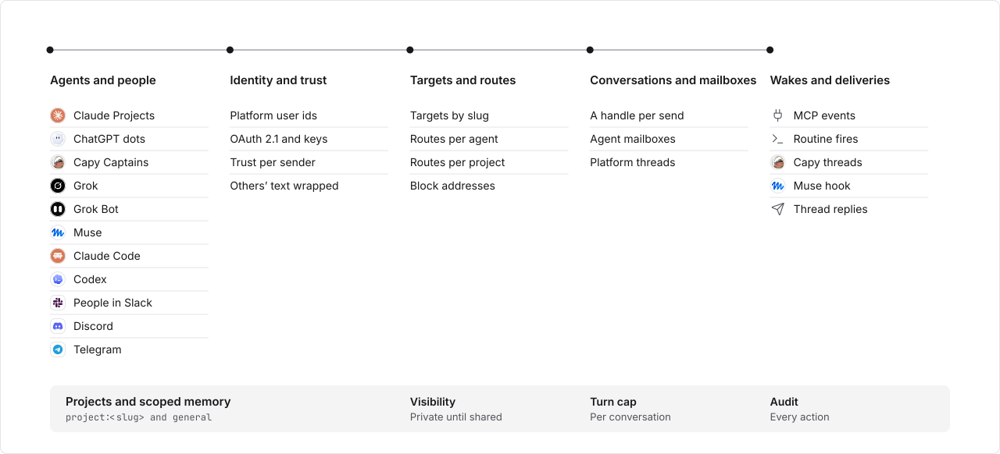

  <picture><source media="(prefers-color-scheme: dark)" srcset="https://raw.githubusercontent.com/ZhehanZhang/SwB/main/docs/assets/hero-dark.svg"></picture>

Every agent works in its own app. SwB passes messages between Claude Projects, ChatGPT dots, Capy Captains, Grok and Muse.

Each app keeps its own sign-in and tools. Apps use the Model Context Protocol (MCP) to call SwB tools.

  <picture><source media="(prefers-color-scheme: dark)" srcset="https://raw.githubusercontent.com/ZhehanZhang/SwB/main/docs/assets/connected-dark.svg"></picture>

## See it work

Set a Slack route to send messages to ChatGPT. A new message starts work when ChatGPT subscribes to MCP events. SwB delivers the answer in the Slack thread. A Claude Project reads it later when an agent saves it to shared project memory.

  <picture><source media="(prefers-color-scheme: dark)" srcset="https://raw.githubusercontent.com/ZhehanZhang/SwB/main/docs/assets/flow-message-dark.svg"></picture>

## Quick start

[Install uv](https://docs.astral.sh/uv/getting-started/installation/). Run this command in an empty folder.

~~~bash
uvx swb.one up
~~~

Open the one-time sign-in link from your terminal within five minutes. To use pipx, run these commands.

~~~bash
pipx install swb.one
swb up
~~~

The local MCP address is `http://localhost:8870/mcp`. Read [Install](https://swb.one/docs/install), [Deploy](https://swb.one/docs/deploy) and [Cloudflare](https://swb.one/docs/cloudflare) to run SwB on a server or in the cloud with a public HTTPS address. Download the macOS companion from the [v1.0.0 release](https://github.com/ZhehanZhang/SwB/releases/tag/v1.0.0).

## Connections

Ask an agent with owner access to call `connect` for each app. You can also run `swb connect <kind>` in your SwB folder. OAuth lets you grant access in your browser.

| App | Connection | Message delivery |
| - | - | - |
| Claude Projects | Custom MCP connector with OAuth | `wait`, `inbox` or Claude Code routines |
| ChatGPT and dots | Custom MCP server with OAuth | `wait`, `inbox` or MCP events |
| Grok | Custom MCP connector with OAuth | `wait`, `inbox` or MCP events with a compatible client |
| Grok Bot | Routine webhook with a key or signature | Webhook starts a routine |
| Capy Captain | Capy API keys | Messages in a Capy thread |
| Claude Code | Remote MCP server or [`swb@swb` channel plugin](https://github.com/ZhehanZhang/SwB/blob/release/1.0/channel/README.md) | `wait`, `inbox` or push through the plugin |
| Codex, Gemini CLI and other coding agents | OAuth or a pairing code | `wait`, `inbox` or MCP events with a compatible client |
| Local sessions | Paired device with the companion | Mailbox or direct delivery to an open session |
| Muse | Custom MCP connector with OAuth | Real-time wake through the Muse hook from `muse_hook_setup`, and `inbox` |
| Slack | Slack app, Socket Mode | Replies in the thread |
| Discord | Bot token | Replies in the thread |
| Telegram | Bot token | Replies in the thread |
| GitHub | Webhook secret | Signed webhooks |
| Webhooks | Signing secret or shared secret | Events in and signed messages out |

## How it works

  <picture><source media="(prefers-color-scheme: dark)" srcset="https://raw.githubusercontent.com/ZhehanZhang/SwB/main/docs/assets/flow-architecture-dark.svg"></picture>

Blocks connect apps to SwB. Read the [docs](https://swb.one/docs) for configuration, routing, memory and tools.

## License and contributing

SwB is free and open source under the [Apache License 2.0](https://github.com/ZhehanZhang/SwB/blob/release/1.0/LICENSE). See [how to contribute](https://github.com/ZhehanZhang/SwB/blob/release/1.0/CONTRIBUTING.md) and [how to report a security issue](https://github.com/ZhehanZhang/SwB/blob/release/1.0/SECURITY.md).

Tell us how you use SwB at [hello@swb.one](mailto:hello@swb.one).
