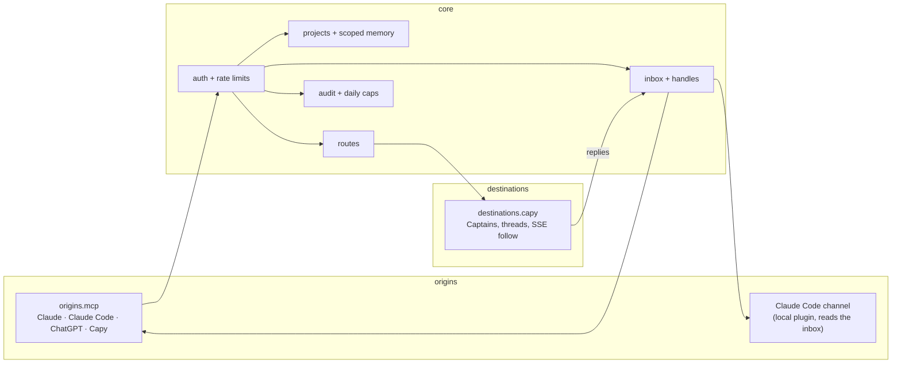

# switchboard

the owner's self-hosted switchboard. Assistants come in through **origins**, the **core** gives them one scoped shared
memory, a project list, routes, an inbox and an audit log, and the core sends work out to **destinations**. The first
origin is MCP (the Claude app, Claude Code, ChatGPT and Capy over OAuth or bearer keys). The first destination is Capy
(Captains and threads, with their replies coming back).

It runs as a docker compose app on your-host, behind a Cloudflare tunnel at `https://swb.example.com`.



Origins and destinations sit behind two small interfaces (`origins/__init__.py`, `destinations/__init__.py`). An
origin authenticates callers into a `Principal` and calls the core. A destination declares actions, and the core runs
every action through caps and the audit log. Neither imports the other. To add one, subclass the interface, list it in
`ORIGINS` or `DESTINATIONS`, and configure it under `origins.<name>` or `destinations.<name>`. A Slack origin and
destination built on slackgate would slot in there; neither exists yet.

## What "shared memory" means, honestly

Claude's and ChatGPT's built-in memories are private to each product. **No MCP server can read or write them**, and this
one doesn't try. "Shared" means a third store every assistant uses through the `memory_*` and `context_pack` tools,
plus an instruction snippet in each product (below) telling the model to load the briefing and save durable facts. An
assistant that isn't told to use the tools won't.

## Scopes and projects

Every memory lives in exactly one scope: `general` (the owner's profile, preferences, cross-project decisions) or
`project:<slug>`. Projects are first-class (`project_list`, `project_create`, `project_update` for renames, links and
archiving). Each can be linked to a Capy project, repos, a Claude Project name and a ChatGPT project name, and
`project_list(hint=...)` finds the project for any of those.

A Claude or ChatGPT connector is account-wide, so switchboard can't tell which Claude Project or ChatGPT project a call
comes from: the scope comes from the instruction snippet, and the model can get it wrong. So the defaults lean towards
the project, and every step out of it is explicit:

- Writes must name their scope and are never implicitly general. An archived project refuses writes.
- **Writing to `general` needs `confirm_general=true`.** Without it the write fails and tells the model to write to
  the project scope, or to confirm with the owner that this applies everywhere.
- **A write that names `project` can't land in another project.** If `project` and `scope` disagree, it's rejected.
  Every write result echoes the scope it landed in.
- **Fixing a wrong scope is explicit.** `memory_move(id, to_scope)` moves an entry to another project, and
  `memory_promote(id)` moves it to general. Both keep the id and revision history and are audited.
- **Reads cover the named project plus general.** `memory_search`, `memory_list` and `context_pack` take `project`
  (`include_general=false` for the project alone); without one they read general only. Reading another project needs
  an explicit `scopes=[...]`, which is written to the audit log.
- **Private projects** (`private: true` on `project_create` / `project_update`) can't be pulled into another project's
  read at all, even with `scopes`; only a read that names them as `project` sees them.
- **Bearer keys can be limited to scopes** with `auth.key_scopes`, e.g. `{acme-agent: [project:acme]}`. A limited key
  can't read or write outside its list, can't create projects or change routes, and must delegate with a project.
- Rows written by capy-bridge 0.1 were migrated into `general`.

New projects link themselves. `project_create` (and `project_update` while `links.capy_project` is empty) looks the
project up in Capy: an exact repo match beats a name or slug match. It then routes the project to that Capy project's
Captain in `captain_thread` mode with the project's repos, when there is exactly one. Ambiguous or missing matches
change nothing and come back as candidates in `result.auto`, so the assistant can ask the owner. Existing links and
routes are never replaced unless the call passes `force`. `project_sync(slug?)` reruns this for one or every project,
and every automatic change is audited with source `auto` (routes get `updated_by: auto`).

## Routes

A route maps an agent (the OAuth client's agent name such as `claude`, `chatgpt`, `claude-code`, or a bearer key name),
a project, both, or neither to a Capy target: a Captain (by name or id), a Capy project (new thread there), or a
thread. Defaults can carry a model, repos, `mode` (`captain_thread` messages the Captain, `new_thread` starts a crew
thread) and a delivery mode. Resolution order is **agent+project, then project, then agent, then global**.

`capy_delegate` without a target uses the route. An explicit target is refused unless the matching route has
`allow_override` (with no route at all, an explicit target is the only way). Route targets are checked against the
Capy API when set. Every route write, refusals included, is in the audit log. `routes_list`, `routes_set`,
`routes_remove` and `routes_resolve` manage them, and the admin page at `/` shows them with the projects and recent
changes. `destinations.capy.default_route` seeds the global route once on a fresh install.

## Getting Capy's answer back

`capy_delegate` returns a **handle** at once. Switchboard then follows the Capy thread over its SSE stream
(`GET /threads/{id}/stream`, resuming with `Last-Event-ID` after any drop, with exponential backoff plus jitter) and files
each reply, question for the owner, status change and final result in the caller's **inbox**. Handles and stream
cursors live in SQLite, so following resumes after a restart. A new thread is finished when it comes to rest after
replying.

Correlation is server-side only. Nothing in the message asks the model to keep, echo or paste a token, handle or
marker. Each delegation is bound when it is created to the authenticated caller (OAuth client or key, giving the agent
name), the project, and the ids Capy returns for it: the new thread's id, or for a message into a Captain or an
existing thread, the message's `clientKey` and id. In a shared thread, assistant output belongs to the delegation
whose message is the latest user entry in Capy's stream. A later message from anyone else ends that, so a Captain's
answer to the owner never lands in an agent's inbox. That delegation finishes when the thread comes to rest (idle or
waiting) after replying. Handles are optional: `capy_wait` and `capy_inbox` with no arguments return everything
pending for the caller (`project` narrows it), and a caller can only ever read its own items. Using another caller's
handle gets "no handle". Each item has a `from` taken from Capy's data: the thread id and title, the entry's author and
message id, and Capy's `sender` when another agent sent it. Text in a message never changes it. `agent_send` leaves
a message in another agent's mailbox, attributed to the calling connection. That is the start of the A2A mailbox.

Three ways to read the inbox, depending on the client:

| Client | How the answer comes back |
| - | - |
| claude.ai, Claude Desktop, ChatGPT | The tool descriptions teach **delegate, then `capy_wait()`, then answer**. `capy_wait` long-polls and returns as soon as something arrives. claude.ai cuts tool calls at 240 s, so it defaults to 60 s and is capped at 200 s; if it times out, the model says Capy is still working and checks again. `capy_inbox` never blocks. |
| Clients with MCP Tasks | When a `tools/call` advertises `io.modelcontextprotocol/tasks` in its per-request capabilities (protocol 2026-07-28), `capy_delegate` answers with a task whose id is the handle, and `tasks/get` completes it with Capy's final reply. Per Anthropic's docs this covers the Claude Code CLI (v2.1.304+), VS Code and local Desktop app sessions (v2.1.331+), Claude Code cloud sessions, and new chats in the unified Claude app on Pro, Max, Ultra and Team when switchboard is added as a claude.ai connector. Project threads, incognito chats, and servers loaded from `.mcp.json` in cloud sessions get no tasks and fall back to the handle plus `capy_wait`. `tasks/cancel` stops following (the Capy thread keeps running). |
| Claude Code, open session | The **channel** below pushes replies straight into the session. |

Claude Code's own timeout matters for `capy_wait`: an HTTP request with no response byte within
max(60 s, `MCP_TOOL_TIMEOUT`, `MCP_TIMEOUT`) fails, so the `claude-code` agent defaults to 45 s and is capped at 55 s.
Raise `origins.mcp.wait.agents.claude-code` only together with `MCP_TOOL_TIMEOUT`. `switchboard_status` shows each
caller its limits. No feature depends on MCP resource subscriptions or server notifications, which claude.ai doesn't
support.

### Claude Code channel (research preview)

`channel/` is a small Bun channel server and plugin. It reads `GET /inbox/events` (SSE; `GET /inbox/poll` is the
long-poll alternative) with a bearer key and turns every inbox item into a `notifications/claude/channel` event, so
Capy's replies show up in the Claude Code session that's open. **It only works while that session is open.** Items that
arrive in between are delivered at the next start, from the cursor it saves. It's one-way: to answer Capy, Claude uses
the switchboard MCP server's `capy_reply`.

Install, during the research preview (custom channels aren't on Anthropic's allowlist, so they need the development
flag, and Team or Enterprise organizations must enable channels):

1. On your-host, read the channel key: `sudo grep '^SWITCHBOARD_KEY_CHANNEL=' /srv/swb/.env`.
   Paste it only into Claude Code's config prompt, never into a chat.
2. Install [Bun](https://bun.sh), then in Claude Code run `/plugin marketplace add ZhehanZhang/switchboard` and
   `/plugin install switchboard@switchboard`. Enter the URL and the key when it asks.
3. Start sessions with `claude --dangerously-load-development-channels plugin:switchboard@switchboard`.

Without the plugin wrapper, a bare server works too: add
`{"mcpServers": {"switchboard-channel": {"command": "bun", "args": ["/path/to/channel/switchboard-channel.ts"], "env": {"SWITCHBOARD_KEY": "..."}}}}`
to `.mcp.json` and start with `--dangerously-load-development-channels server:switchboard-channel`.

## Tools

| Tool | What it does |
| - | - |
| `context_pack` | Session briefing for a project: its memory and links, general profile and decisions, the routed Captain's digest, its relevant crew work and open asks, delegations in progress |
| `memory_write` | Create or update an entry: `scope` (required), `namespace`, `title`, `body`, optional `key`, `tags`, `mode=append`, `project` (the project you work in), `confirm_general` |
| `memory_search` / `memory_list` | FTS5 search and listing, project first then general; `scopes` for an explicit, logged cross-project read |
| `memory_read` / `memory_delete` | One entry with its edit history; soft delete |
| `memory_move` / `memory_promote` | Move an entry to another project, or to general; audited, history kept |
| `project_list` / `project_create` / `project_update` | Projects and their links; rename, archive, private; automatic Capy link and route |
| `project_sync` | Rerun the automatic link and route for one or every project, reporting changes and candidates |
| `routes_list` / `routes_set` / `routes_remove` / `routes_resolve` | Routes, audited |
| `switchboard_status` | Your agent name, your `capy_wait` limits, what's configured or degraded |
| `capy_delegate` | Send a task along your route (or an allowed explicit target), with repos, files, `new_thread`, `wait_s`; returns a handle, or an MCP task |
| `capy_wait` / `capy_inbox` | Long-poll or read what Capy reported |
| `capy_status` / `capy_result` | Thread status, PRs and latest messages; the final reply in full with file links |
| `capy_list` / `capy_reply` / `capy_cancel` | Delegations, a Captain's crew, or a project's threads; a follow-up; stop following |
| `capy_captain_digest` / `capy_captains` | A Captain's digest and crew asks; the Captains the key can see |

The writing agent comes from the credential, never from a tool argument. Capy tools only appear when
`destinations.capy` is configured, and answer that the key is missing until `CAPY_API_KEY` is set.

## Authentication and protection

The server is its own single-owner OAuth 2.1 authorization server, built to the stricter of Claude's and ChatGPT's
requirements: protected resource metadata (RFC 9728) and a `401` with `resource_metadata` on `/mcp`; authorization
server metadata (RFC 8414) with PKCE `S256` only, CIMD from allowlisted hosts, DCR (RFC 7591) and RFC 9207 `iss`;
redirect URIs limited to Claude's, ChatGPT's and loopback; tokens bound to `<public_url>/mcp`; 1 h access tokens and
rotating 30-day refresh tokens with replay detection, stored only as SHA-256 hashes.

**Only Owner can approve a sign-in or open the admin page, and there is no password form anywhere.** The whole
hostname sits behind the Cloudflare Access app "Switchboard" (policy "Owner Only", identity provider SSO,
the same setup as his other apps), and the server verifies the Access JWT itself (signature, audience, issuer, owner
email), so a request that bypasses the tunnel is refused too. The admin page (status, routes, projects, recent
refusals) is at `/`. A second Access app, "Switchboard machine paths (bypass)", lets through only what machines call:
`/mcp`, `/token`, `/register`, `/revoke`, `/.well-known`, `/healthz` and `/inbox` (the Claude Code channel). Those carry
their own OAuth or bearer checks. Without `auth.cloudflare_access` in config, OAuth sign-in and the admin page are off
and only bearer keys work.

In front of everything:

- A wrong bearer token on `/mcp` or `/inbox/` is audited (`auth_failure`) and counts against the caller's IP: after 20
  in 10 minutes that IP gets `429` for the rest of the window. Requests without a token (OAuth discovery) aren't counted.
- `/register` allows 20 per IP per hour, `/token` 120 and `/authorize` 60 per 10 minutes; refusals are audited
  (`rate_limited`).
- Request bodies are limited to 1 MiB, or 16 MiB on `/mcp` for file attachments.

Clients without OAuth use bearer keys: `SWITCHBOARD_KEY_<NAME>` in `.env`, where `<NAME>` becomes the agent name.

## Delegation guardrails

- Repos a task names must be linked to its project (`links.repos`), or to any project when it has none.
- `capy_status`, `capy_result` and `capy_reply` only touch threads delegated through switchboard, routed Captains and
  their crews, routed threads, and threads in routed or linked Capy projects.
- Delegating is meant to be routine, so nothing rations it. Two guards catch runaways only:
  - Burst: more than `destinations.capy.burst.count` delegations (default 10) from one caller within `burst.window_s`
    (default 600 s) looks like a loop, and the next one is refused with that explanation.
  - Duplicates: the same caller sending the same task to the same target within `duplicate_window_s` (default 600 s)
    gets the existing handle back instead of a second thread.
  - `capy_reply` and `capy_wait` are never limited. `daily_cap` is an optional hard daily limit, off by default.
  - Retries the API sees again are also deduplicated through its `requestId` / `clientKey`.
- Capy attributes a message to the API key that sent it. `CAPY_API_KEY` does the reads and stream following. Sends
  (delegations, replies, new threads) try, in order, the agent's own `CAPY_API_KEY_AS_<AGENT>` (for example
  `CAPY_API_KEY_AS_CLAUDE` or `CAPY_API_KEY_AS_CLAUDE_CODE`), then the service user's key (`send_key_env`, default
  `CAPY_API_KEY_SERVICE`). A 401 or 403 moves to the next key and writes a `send_key_fallback` row. When every key
  is refused, the send fails with a `send_refused` row. Relays never send as `CAPY_API_KEY` unless
  `destinations.capy.identity: personal` is set (one key, sends show as you). A service user only sees what is shared
  with it, so share the Captains with it and give it access to the device they run on. On startup and every 30 minutes,
  each key is checked against `GET /captains` and a send-path no-op on each routed Captain or thread. `/healthz`
  (`send_keys`) and the root page then show it as ok, no project access, no device access, or rejected, and they show
  which key sends for each agent.
- Bearer sign-in failures are in the audit log without the key: `auth_failure` records a wrong token's length and
  paste mistakes (whitespace, quotes, a doubled "Bearer") or a non-Bearer header, and `auth_missing` records a
  request with no header, at most once per address per 10 minutes.
- Every action that changes something, and every refusal, is in the audit log (`docker compose exec switchboard switchboard log`).
- The Capy API key is only ever sent as a header to api.capy.ai; it is never logged, and access logs drop query strings.

## Running it

```bash
cp .env.example .env && chmod 600 .env          # the owner types CAPY_API_KEY; generate keys with openssl rand -hex 32
cp config/switchboard.example.yaml config/switchboard.yaml
docker compose up -d --build                    # MCP on http://127.0.0.1:8870/mcp
docker compose --profile tunnel up -d           # adds cloudflared (TUNNEL_TOKEN in .env)
curl -s http://127.0.0.1:8870/healthz
```

Without `CAPY_API_KEY` the server runs **degraded**: memory, projects and routes work, Capy tools say the key is
missing, and `/healthz` and the status page at `/` say what's off. Tests run in the image build
(`docker build --target test .`); the channel has its own (`cd channel && bun test`). A legacy `capy-bridge.db` in the
data directory is renamed to `switchboard.db` on first start.

Markdown export: `docker compose exec switchboard switchboard export /data/export` writes one folder per scope
(`general/`, `projects/<slug>/`) plus `INDEX.md`. Setting `memory.mirror_dir` keeps that tree in sync: after a change, and once at startup,
it's rewritten with atomic renames, and files and folders for deleted or moved entries are removed. A burst of
writes collapses into one export after `mirror_debounce_s` (default 2 s) of quiet, at most ten times that after the
first change. It's one-way: edits in the mirror are never read back. `mirror: false` switches it off.

The deployment mirrors into Capy Drive (`user-owner/switchboard-memory/`): a git-ignored `compose.override.yaml`
binds that folder at `/mirror`, and `SWITCHBOARD_UID` in `.env` builds the image to run as the uid that owns it.

The pages (consent, status, routes) follow the owner's sites (example.com, status.example.com, id.example.com): the
same type, hairline cards, the Arc backdrop, the signature and the shared theme cookie, ported from example-org/id-site.

## Connecting the assistants

- **Claude** (claude.ai, Desktop, mobile): Settings → Connectors → Add custom connector → `https://swb.example.com/mcp`,
  sign in with SSO, approve.
- **ChatGPT**: Settings → Apps → Advanced settings → Developer mode, then Create app → `https://swb.example.com/mcp`, OAuth.
- **Claude Code**: `claude mcp add --transport http switchboard https://swb.example.com/mcp`, plus the channel above if wanted.
- **Capy**: an MCP server with URL `https://swb.example.com/mcp` and OAuth with the Automatic client. Capy registers
  itself (DCR, redirect `https://capy.ai/web/callbacks/mcp`), the consent page shows "Capy", and any client that
  returns to capy.ai signs in as agent `capy`, so routes, `key_scopes` and the audit log treat it the same as the old
  key. The fallback is a header `Authorization: Bearer <SWITCHBOARD_KEY_CAPY>`; a bare key without `Bearer ` works too.
  Read the key on your-host with `sudo grep '^SWITCHBOARD_KEY_CAPY=' /srv/swb/.env`
  and paste it straight into Capy's settings, never into a chat.

## Instruction snippets

**Claude Project instructions** (one per Claude Project; replace `<slug>` with its switchboard project):

> You have the switchboard connector, a memory shared with my other assistants and Capy. This Project is switchboard
> project `<slug>`. At the start of a conversation call context_pack(project="<slug>"). When I state a durable fact,
> preference or decision, save it with memory_write(scope="project:<slug>", project="<slug>"). Use scope "general"
> only for things about me that hold in every project, after asking me, with confirm_general=true. Use a key for
> things that get updated, and tell me in one line. Search memory before asking me something I may have said. Don't
> read other projects' memory unless I ask. For work that needs a machine, a repo, a PR, research or a long run, or
> that my Captain should know about, use capy_delegate(project="<slug>"), then capy_wait on the handle and give me
> Capy's answer; follow up with capy_reply.

**ChatGPT project instructions** (one per ChatGPT project, same `<slug>` rule):

> When the switchboard app is enabled, this project is switchboard project `<slug>`: call context_pack(project="<slug>")
> first. Save durable facts and decisions with memory_write(scope="project:<slug>", project="<slug>"), and say so
> briefly. Write to "general" only for things about me everywhere, after asking me, with confirm_general=true. Search
> memory before asking me something I may have said, and stay out of other projects' memory unless I ask. Hand coding,
> repo, PR, research and long-running work to my Capy Captain with capy_delegate(project="<slug>"), then capy_wait on
> the handle and report the answer.
> Your own ChatGPT memory is separate; the shared one is switchboard.

**Personal preferences / custom instructions** (outside projects): ask which project the conversation is about and
use it; with none, read general, and write to general only after asking, with `confirm_general=true`.

**Capy (AGENTS.md or scope instructions)**:

> Shared memory with the owner's other assistants lives in the switchboard MCP server. Read context_pack with the
> project you work on, and record decisions and durable facts with memory_write in that project's scope (pass
> project too). General needs confirm_general=true and is for things that hold in every project.

## Layout

```
src/switchboard/
  core.py            the Switchboard core: wiring, invoke (caps + audit), routes, context pack
  auth.py            OAuth 2.1 authorization server (DCR, CIMD, PKCE, refresh rotation, Access check)
  guard.py           body size limits, rate limits, bearer lockout
  projects.py memory.py routes.py inbox.py audit.py store.py
  origins/mcp/       MCP tools (MCP Python SDK, streamable HTTP, stateless) and the Tasks extension
  destinations/capy/ Capy API client, SSE thread follower, actions
  app.py pages.py static/   HTTP app, inbox endpoints, status, consent and routes pages
channel/             Claude Code channel (Bun) and its plugin manifest
```
