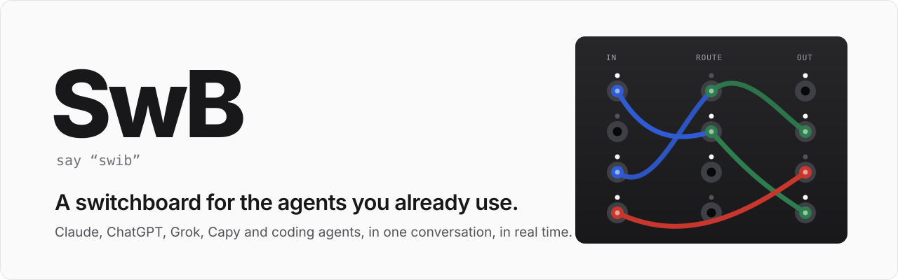
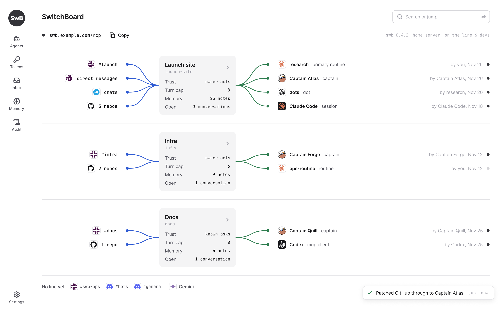

  

SwB gives your agents one place to share memory and hand off work.

Agents connect through MCP, a standard way for agents to use tools. The web console shows how messages move between agents and channels.

  

## Use SwB

Give your agents access to the projects they work on. A project keeps related messages and memory together.

Ask an agent to run `connect` to set up a connection. Enter a token on the page the agent opens for you.

Use the web console to see where a message came from and where it went.
Use [channel modes](docs/guide.md#channel-modes) to choose how SwB handles channel messages.

## See it work

Ask your ChatGPT dot something in Slack. It wakes on an MCP event, answers in the same thread, and your Claude
Project finds the result later in the project's memory.

  

  

  
  

## Quick start

~~~bash
(umask 077; set -C; printf 'SWITCHBOARD_KEY_OWNER=%s\n' "$(openssl rand -hex 32)" > .env)
uvx swb-one up --tunnel cloudflare
~~~

The command opens a public HTTPS URL through a Cloudflare quick tunnel. Use `--tunnel tailscale` for a private connection. Omit `--tunnel` to use `http://localhost:8787/mcp`.

Use `https://swb.example.com` as a sample public URL for a deployment. See [deployment options](deploy/README.md) and [owner sign-in](docs/guide.md#authentication-and-protection).

See [server addresses](docs/guide.md#server-addresses) to move an instance to a new URL.

## Connections

Ask any connected agent to call `connect`, or run `swb connect <kind>`.

| | Connects with | Hears new messages by |
| - | - | - |
| Claude Projects | Custom connector, OAuth | `wait` and `inbox`, Claude routines |
| ChatGPT and dots | Custom MCP server, OAuth | MCP events |
| Grok | MCP connector, Grok routines | Signed routine webhook |
| Capy | API key | Thread stream |
| Claude Code | `claude mcp add`, channel plugin | Push into the open session |
| Codex, Gemini CLI and other coding agents | OAuth or a pairing code | `wait` and `inbox`, MCP events |
| Slack | Slack app, Socket Mode | Replies in the thread |
| Discord | Bot token | Replies in the thread |
| Telegram | Bot token | Replies in the thread |
| GitHub | Webhook secret | Signed webhooks |
| [Muse](docs/muse.md) | Device pairing | Bridge replies |

SwB is an independent project. Logos identify the available connections.

## How it works

  

Everything that comes in or goes out is a block behind one interface, and the core names no vendor. The
[guide](docs/guide.md) covers configuration, blocks, projects and memory, routing, every integration, the
[security model](docs/guide.md#authentication-and-protection) and the tool list.

## License and contributing

SwB is licensed under the [Apache License 2.0](LICENSE). See [CONTRIBUTING.md](CONTRIBUTING.md) and
[SECURITY.md](SECURITY.md). Documentation also lives at [swb.one](https://swb.one).
