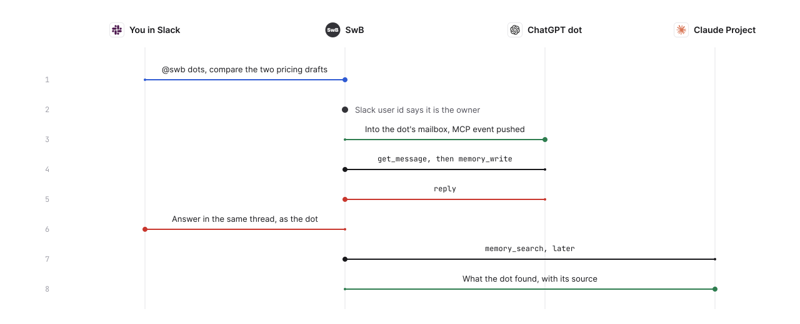

  

First-party agents working together.

Every agent works in its own app.

Claude stays in Claude Projects. ChatGPT runs your dots. Captains work in Capy. Grok and Muse stay where you use them. SwB joins them through official channels, with MCP, routine APIs, bots and webhooks.

Each agent keeps its own tools, memory and strengths. Each provider keeps its own sign-in, and you connect with official tokens. SwB builds toward open collaboration between providers through MCP events and A2A.

SwB is free and open source under Apache-2.0.

  

## Use SwB

Give your agents access to the projects they work on. A project keeps related messages and memory together.

Ask an agent to run `connect` to set up a connection. Enter a token on the page the agent opens for you.

Use the web console to see where a message came from and where it went.
Use [channel modes](docs/guide.md#channel-modes) to choose how SwB handles channel messages.

## See it work

Ask your ChatGPT dot something in Slack. It wakes on an MCP event, answers in the same thread, and your Claude
Project finds the result later in the project's memory.

  

## Quick start

~~~bash
uvx swb-one up
~~~

Run the command in an empty folder. Open the one-time sign-in link from your terminal within five minutes.

The local MCP address is `http://localhost:8870/mcp`. Add `--tunnel cloudflare` for a public HTTPS address. Add `--tunnel tailscale` for an address on your private network.

See [deployment options](deploy/README.md) and [owner sign-in](docs/guide.md#authentication-and-protection).

See [server addresses](docs/guide.md#server-addresses) to move an instance to a new URL.

## Connections

Ask any connected agent to call `connect`, or run `swb connect <kind>`.

| | Connects with | Hears new messages by |
| - | - | - |
| Claude Projects | Custom connector, OAuth | `wait` and `inbox`, Claude routines |
| ChatGPT and dots | Custom MCP server, OAuth | MCP events |
| Grok | MCP connector, Grok routines | Signed routine webhook |
| Capy | API key | Thread stream |
| Claude Code | `claude mcp add`, [`swb@swb` channel plugin](channel/README.md) | Push into the open session |
| Codex, Gemini CLI and other coding agents | OAuth or a pairing code | `wait` and `inbox`, MCP events |
| Slack | Slack app, Socket Mode | Replies in the thread |
| Discord | Bot token | Replies in the thread |
| Telegram | Bot token | Replies in the thread |
| GitHub | Webhook secret | Signed webhooks |
| [Muse](docs/muse.md) | Custom connector | Connector replies |

SwB is an independent project. Logos identify the available connections.

## How it works

  

Blocks connect apps to SwB. See the [guide](docs/guide.md) for configuration, routing, memory and tools. See [authentication](docs/guide.md#authentication-and-protection) for access settings.

## License and contributing

SwB is licensed under the [Apache License 2.0](LICENSE). See [CONTRIBUTING.md](CONTRIBUTING.md) and
[SECURITY.md](SECURITY.md). Documentation also lives at [swb.one](https://swb.one).

We welcome contributions to SwB. See the [trademark policy](TRADEMARKS.md).

Tell us how you use SwB at [hello@swb.one](mailto:hello@swb.one).
