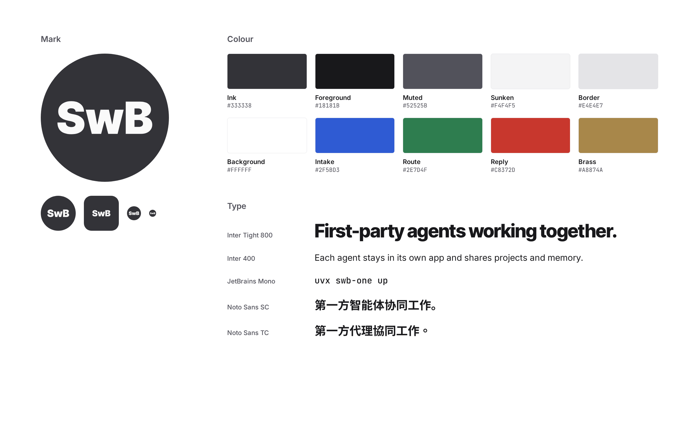

# SwB press kit

This folder holds the official SwB artwork. Use it to write about SwB or to announce it. SwB is said "swib".

## Name

Write SwB with a capital S, a small w and a capital B. Use the word switchboard in descriptions. The Python package is `swb-one`. The command is `swb`. The website is [swb.one](https://swb.one).

## Description

The approved descriptions are in [boilerplate](boilerplate). Each file has one sentence, a short version and a full version.

| Language | File |
| --- | --- |
| English | [en.md](boilerplate/en.md) |
| Simplified Chinese | [zh-Hans.md](boilerplate/zh-Hans.md) |
| Traditional Chinese | [zh-Hant.md](boilerplate/zh-Hant.md) |

## Files

| Folder | Content |
| --- | --- |
| [brand/logo](brand/logo) | The SwB mark in SVG and in PNG from 64 to 2048 pixels |
| [brand/avatar](brand/avatar) | Square profile pictures from 128 to 1024 pixels for a round crop |
| [brand/app-icon](brand/app-icon) | App icons from 16 to 1024 pixels and favicons |
| [brand](brand) | The brand sheet, the colours and the design tokens |
| [screenshots/raw](screenshots/raw) | The SwB console in light and dark at full resolution |
| [screenshots/framed](screenshots/framed) | The same screens in a window or phone frame |
| [social](social) | Launch cards for each platform in three languages |
| [github](github) | The repository social preview and the Open Graph image |

The screenshots show demo data from a local SwB server. Every name, channel and address in them is an example.

## Mark

The mark is a solid circle with the letters SwB. Use the light mark on light backgrounds. Use the dark mark on dark backgrounds. Keep a clear space of one quarter of the mark width on all sides. Use the mark at 24 pixels or larger. Use the files as they are, with their own colours and proportions.

The dark mark is the reversed mark. It has a light circle with dark letters. Use it on dark backgrounds and on dark icon tiles. Both marks are online at stable addresses.

| Mark | SVG | PNG |
| --- | --- | --- |
| Standard | https://swb.one/brand/swb.svg | https://swb.one/brand/swb-512.png and https://swb.one/brand/swb-1024.png |
| Reversed | https://swb.one/brand/swb-reversed.svg | https://swb.one/brand/swb-reversed-512.png and https://swb.one/brand/swb-reversed-1024.png |

## Colour

| Name | Light | Dark | Use |
| --- | --- | --- | --- |
| Ink | `#333338` | `#E4E4E7` | The mark and the accent |
| Foreground | `#18181B` | `#FAFAFA` | Text |
| Muted | `#52525B` | `#A1A1AA` | Secondary text |
| Sunken | `#F4F4F5` | `#18181B` | Panels |
| Border | `#E4E4E7` | `#27272A` | Lines |
| Background | `#FFFFFF` | `#09090B` | Pages |
| Intake | `#2F5BD3` | `#6B8FF0` | Messages that come in |
| Route | `#2E7D4F` | `#4FAE78` | Messages that go out |
| Reply | `#C8372D` | `#E5675C` | Replies |

The full set is in [tokens.json](brand/tokens.json).

## Type

| Font | Use |
| --- | --- |
| Inter Tight | Headings |
| Inter | Text |
| JetBrains Mono | Code and commands |
| Noto Sans SC and Noto Sans TC | Chinese text |

All four fonts use the SIL Open Font License.

## Other logos

The screenshots and cards show the logos of the products that SwB connects. These logos belong to their owners. They show which integrations SwB supports.

## Licence

SwB is open source under the Apache License 2.0. You can use the files in this folder to write about SwB. For questions, open an issue at [github.com/ZhehanZhang/SwB](https://github.com/ZhehanZhang/SwB/issues).
