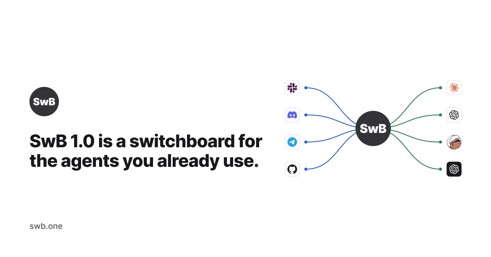

# Launch cards

Each card comes in English, Simplified Chinese and Traditional Chinese, in light and dark. The file name gives the size, the language and the theme. The source is the page 12 Press in the SwB Figma file.

| Platform | File |
| --- | --- |
| Hacker News, Reddit and link previews | `og-1200x630` |
| GitHub | `github-social-1280x640` |
| X and Bluesky | `x-1600x900` |
| LinkedIn | `linkedin-1200x627` |
| Square posts on LinkedIn, Bluesky and Discord | `square-1080x1080` |
| Product Hunt gallery | `producthunt-gallery-1270x760` |
| Product Hunt thumbnail | `producthunt-thumb-240x240` |
| Discord | `discord-banner-960x540` |
| Xiaohongshu | `xiaohongshu-1080x1440` |
| WeChat article cover | `wechat-cover-900x383` |
| WeChat share image | `wechat-square-500x500` |

